# Electgpl — ESP32-C5 Touch LCD 3.5" multi-app firmware

A single-sketch Arduino firmware that exercises **every peripheral** of the
[Waveshare ESP32-C5-Touch-LCD-3.5](https://docs.waveshare.com/ESP32-C5-Touch-LCD-3.5) board through a
PalmOS-style launcher with **23 apps** organized in categories (ALL / HAM / RADIO / TOOLS / GAMES). Among them are an AFSK 1200 / AX.25 / APRS software modem, an SSTV
receiver and transmitter, an RTTY terminal, Wi-Fi 6 / BLE / IEEE 802.15.4 / ESP-NOW radio tools, an ESP-NOW chat, a BLE serial terminal,
an audio function generator, I²C and UART tools, a live camera viewer, an audio spectrum analyzer and a few games.

No external libraries are needed: everything is built on the Arduino-ESP32 core and the ESP-IDF drivers
it ships with (display driver, GUI, DSP, FFT, modems and protocol decoders are all written from scratch).

> Project by **Electgpl** — electronics content on YouTube: [ELECTGPL](https://www.youtube.com/@Electgpl)

## Screenshots

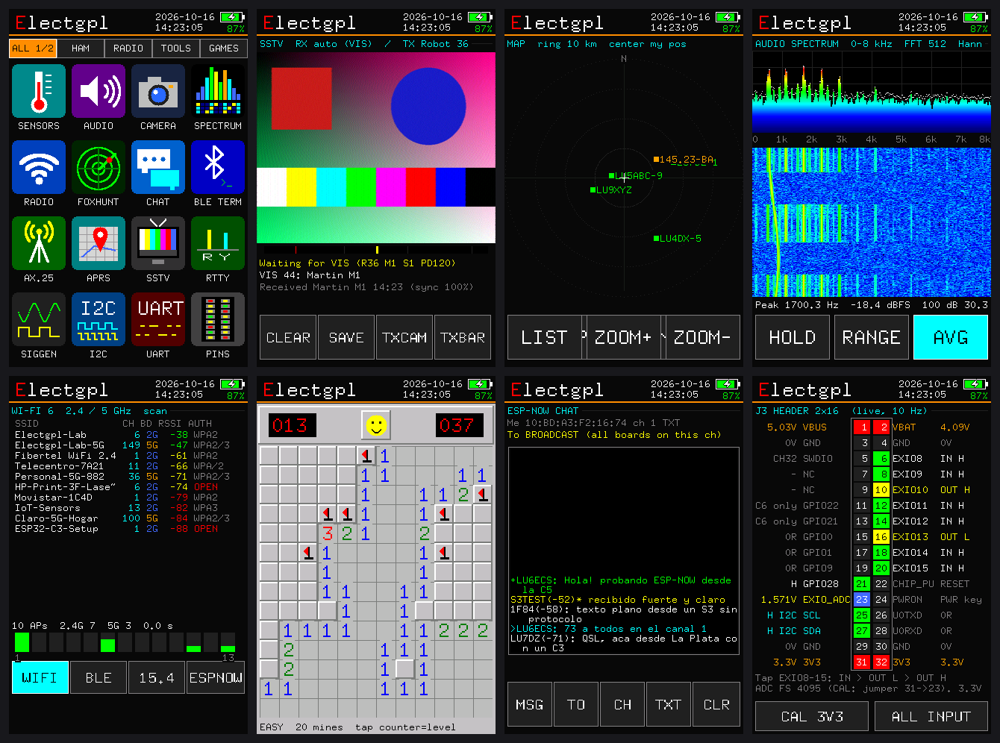

<table>
<tr><td align="center">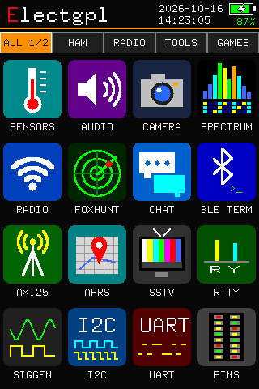<br><sub>Launcher (ALL)</sub></td><td align="center">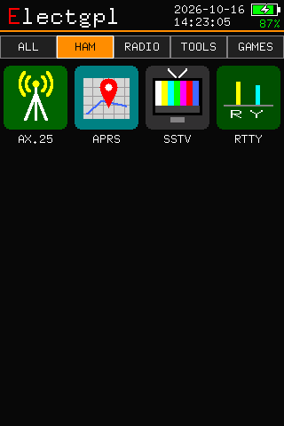<br><sub>HAM category</sub></td><td align="center">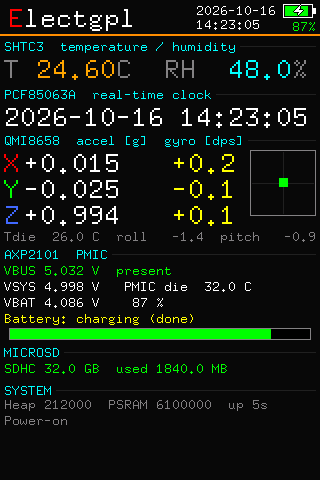<br><sub>SENSORS</sub></td><td align="center">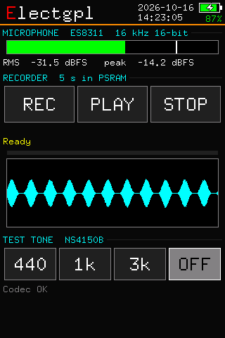<br><sub>AUDIO</sub></td></tr>
<tr><td align="center">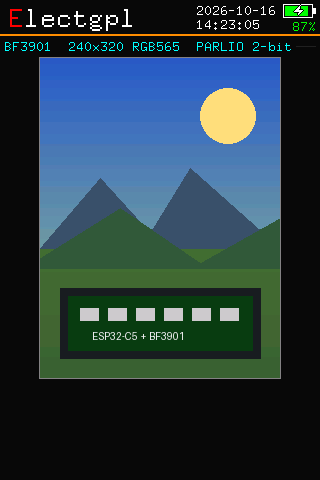<br><sub>CAMERA</sub></td><td align="center">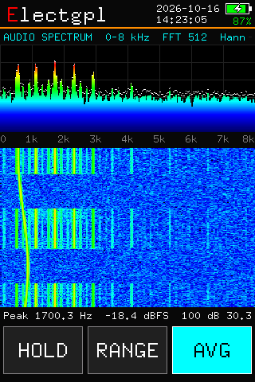<br><sub>SPECTRUM</sub></td><td align="center">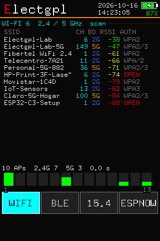<br><sub>RADIO · Wi-Fi 2.4/5 GHz</sub></td><td align="center">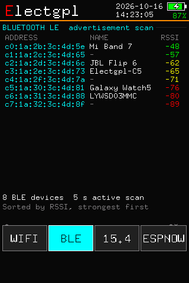<br><sub>RADIO · BLE</sub></td></tr>
<tr><td align="center">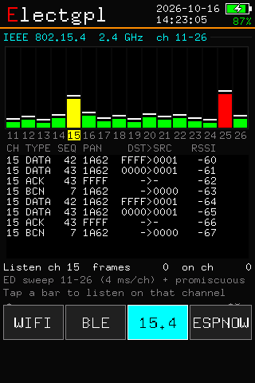<br><sub>RADIO · 802.15.4</sub></td><td align="center">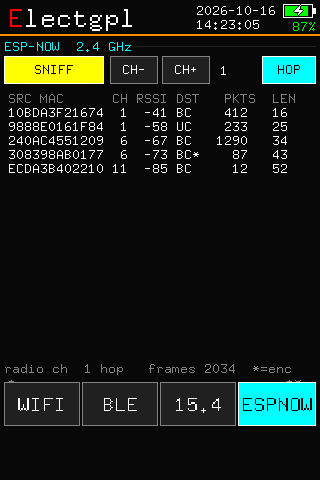<br><sub>RADIO · ESP-NOW sniffer</sub></td><td align="center">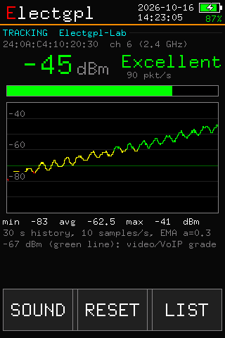<br><sub>FOXHUNT</sub></td><td align="center">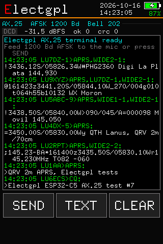<br><sub>AX.25</sub></td></tr>
<tr><td align="center">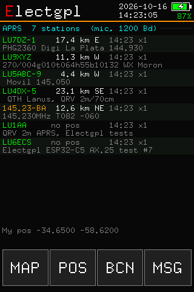<br><sub>APRS stations</sub></td><td align="center">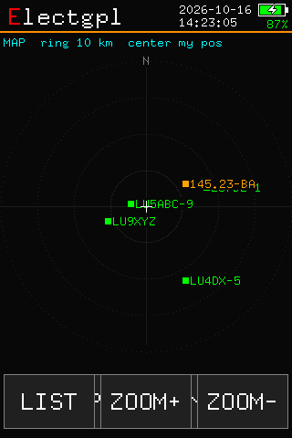<br><sub>APRS map</sub></td><td align="center">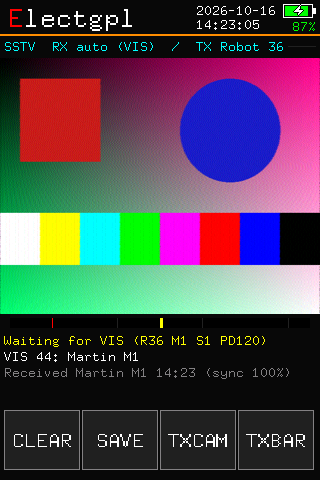<br><sub>SSTV (Martin M1 RX)</sub></td><td align="center">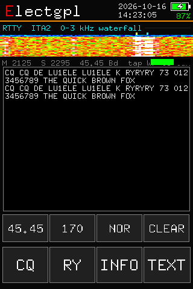<br><sub>RTTY</sub></td></tr>
<tr><td align="center">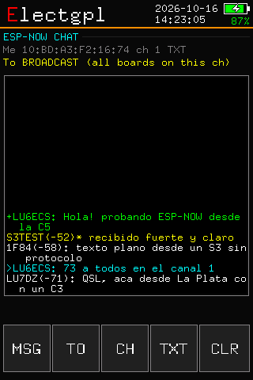<br><sub>CHAT (ESP-NOW)</sub></td><td align="center">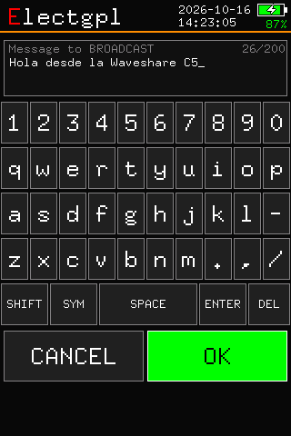<br><sub>On-screen keyboard</sub></td><td align="center">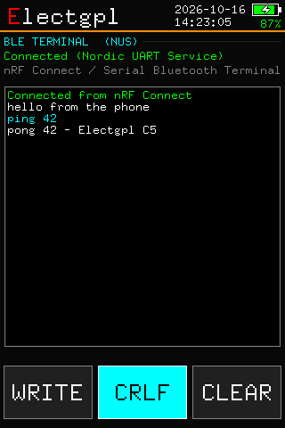<br><sub>BLE TERM</sub></td><td align="center">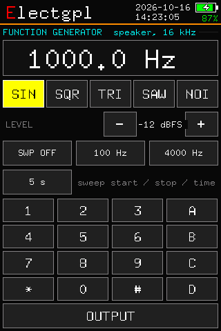<br><sub>SIGGEN</sub></td></tr>
<tr><td align="center">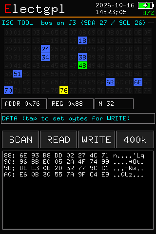<br><sub>I2C tool</sub></td><td align="center">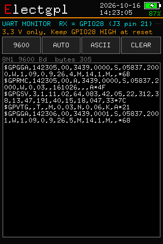<br><sub>UART monitor</sub></td><td align="center">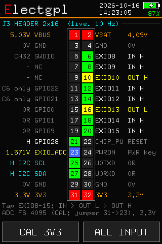<br><sub>J3 PINS</sub></td><td align="center">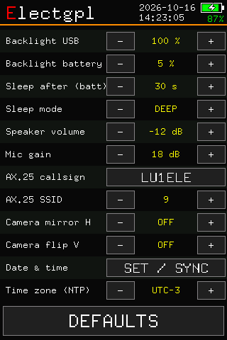<br><sub>SETTINGS</sub></td></tr>
<tr><td align="center">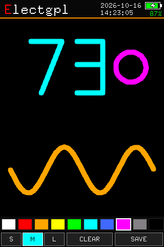<br><sub>PAINT</sub></td><td align="center">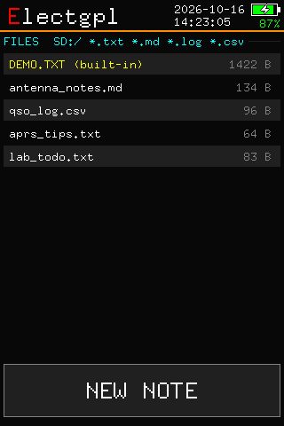<br><sub>NOTES</sub></td><td align="center">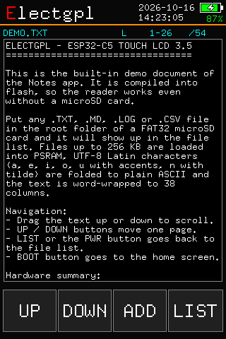<br><sub>NOTES viewer</sub></td><td align="center">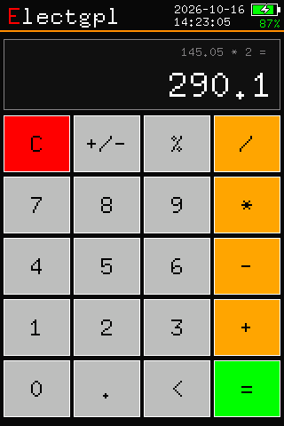<br><sub>CALC</sub></td></tr>
<tr><td align="center">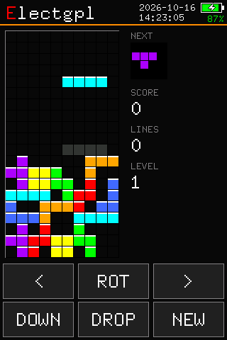<br><sub>TETRIS</sub></td><td align="center">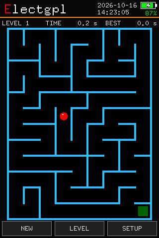<br><sub>MAZE</sub></td><td align="center">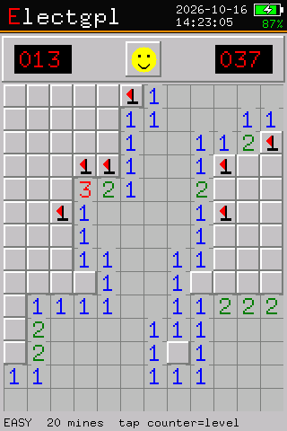<br><sub>MINES</sub></td><td></td></tr>
</table>

> These images were produced by **running the firmware's own drawing code on a PC**: the sketch is compiled on the host
> against an emulation layer whose ST7796 model rebuilds the frame from the exact SPI byte stream (`CASET`/`RASET`/`RAMWR`,
> RGB565). Sensor values, scan results and stations are **synthetic**; the SSTV picture was decoded by the firmware from a
> PySSTV Martin M1 signal and the RTTY text was demodulated from minimodem audio. The layout is pixel-exact; real data on
> the board will differ.

---

## Contents

- [Screenshots](#screenshots)
- [Features](#features)
- [Hardware](#hardware)
- [Building](#building)
- [Usage](#usage)
- [Pin map](#pin-map)
- [Architecture](#architecture)
- [Validation](#validation)
- [Known limitations](#known-limitations)
- [Repository layout](#repository-layout)
- [Credits and licenses](#credits-and-licenses)

---

## Features

| App | What it does |
|---|---|
| **SENSORS** | SHTC3 temperature / humidity, PCF85063A RTC, QMI8658 IMU with bubble level, AXP2101 PMIC (VBUS, VSYS, VBAT, %, charge state, die temperature), microSD info |
| **AUDIO** | ES8311 codec: level meter, 5 s recorder in PSRAM with DC removal and −1 dBFS normalization, playback, WAV export to microSD, test tones |
| **CAMERA** | BF3901 sensor over **PARLIO RX 2-bit**, live 240×320 RGB565 with triple buffering |
| **SPECTRUM** | Fixed-point 512-point FFT (Hann), 0–8 kHz spectrum with peak hold, waterfall, interpolated peak frequency |
| **RADIO** | Wi-Fi 6 dual-band scan (2.4 + 5 GHz), BLE advertisement scan, **IEEE 802.15.4** energy-detect sweep + MAC frame sniffer, **ESP-NOW** sniffer and two-board range test |
| **FOXHUNT** | Wi-Fi RSSI tracker on a single BSSID (promiscuous mode, ~10 samples/s), 30 s chart, Geiger-style audio |
| **AX.25** | Software AFSK 1200 Bd (Bell 202) modem: microphone RX with TNC2-format terminal, speaker TX, free-text frames |
| **APRS** | Decoder for uncompressed, compressed, Mic-E, objects, items, messages and status; station list, detail view, radar map with distance and bearing, position beacon, **APRS messaging** (send, receive, automatic ack) |
| **SSTV** | RX with VIS auto-detection (**Robot 36, Martin M1, Scottie S1, PD 120**), per-line sync and slant correction; TX Robot 36 from the camera or a test pattern; BMP export; STOP and progress |
| **RTTY** | ITA2 Baudot RX/TX, 45.45 / 50 / 75 Bd, 170 / 200 / 425 / 850 Hz shift, NOR/REV, waterfall tuning, CQ / RYRY / INFO macros and free text |
| **CHAT** | ESP-NOW text chat, **interoperable with any ESP-NOW device**: plain-text payloads are received and sent by default (optional EGCH frame with callsign and presence); broadcast or unicast to a picked or typed MAC; delivery from the radio's MAC-level ACK; RSSI per message. A minimal Serial-Monitor peer for any ESP32 is in `tools/ESPNOW_Chat_S3` |
| **BLE TERM** | Nordic UART Service (NUS) peripheral: bidirectional terminal with nRF Connect / Serial Bluetooth Terminal |
| **SIGGEN** | Audio function generator: sine / square / triangle / saw / noise, frequency typed 1–7900 Hz, level in dBFS, linear or log sweep, DTMF keypad |
| **I2C** | I²C tool on the J3 header bus: i2cdetect-style map, register read (hex + ASCII dump) and write, 100/400 kHz, confirmation before writing to on-board devices |
| **UART** | RX-only UART monitor on GPIO28 (J3 pin 21), ASCII/HEX view, autobaud from the shortest pulse |
| **PINS** | Live view of the J3 2×16 header: EXIO8–15 as inputs or driven outputs (tap to cycle), EXIO_ADC voltage calibrated against the 3V3 pin, GPIO28 and I²C line levels, VBUS/VBAT |
| **MINES** | Windows 95 style minesweeper: 12×14 board, 3 levels, safe first click, long-press flags, chording, smiley, counters |
| **PAINT** | Finger painting, 10 colors, 3 brush sizes, persistent canvas, 24-bit BMP export |
| **NOTES** | Text reader for `.txt/.md/.log/.csv` files on the microSD (built-in demo file), UTF-8 Latin folding, word wrap, drag scroll; **new notes and append** with the on-screen keyboard |
| **CALC** | Four-function calculator with %, ±, backspace and chained operations |
| **TETRIS** | 7-bag randomizer, ghost piece, wall kicks, levels, auto-repeat controls |
| **MAZE** | Tilt maze driven by the IMU, with a 3-step axis-mapping wizard, filtered physics and random perfect mazes |
| **SETTINGS** | Persistent settings in NVS: backlight, sleep, volume, mic gain, AX.25 callsign/SSID, camera flip, **date/time with NTP sync** (on-screen QWERTY keyboard for the Wi-Fi password), time zone |

**System-wide**
- **Shared on-screen keyboard**: QWERTY with shift and two symbol layers, forced upper-case mode, decimal and hexadecimal keypads.
- Header with clock and smartphone-style battery icon (percentage and charging bolt).
- **Navigation:** BOOT short press = HOME, PWR short press = BACK, BOOT long press = backlight, tapping the logo = HOME.
- **Battery management:** on battery the backlight drops to a minimum, and after an idle timeout the board enters ESP32-C5 deep sleep (wake by touch or RESET) or AXP2101 power-off (wake by PWR or USB).

---

## Hardware

| Block | Device | Interface |
|---|---|---|
| SoC | ESP32-C5-WROOM-1U (RISC-V 240 MHz, 8 MB PSRAM, 32 MB flash, Wi-Fi 6 2.4/5 GHz, BLE 5, 802.15.4) | — |
| Display | 3.5" IPS 320×480, ST7796 | SPI 40 MHz |
| Touch | FT6336 | I²C 0x38 |
| I/O expander | CH32V006 (LCD/touch reset, backlight PWM, amplifier enable) | I²C 0x24 |
| PMIC | AXP2101 (rails, Li-Po charger, ADC, PWR key) | I²C 0x34 |
| IMU | QMI8658 | I²C 0x6B |
| RTC | PCF85063A | I²C 0x51 |
| T/RH | SHTC3 | I²C 0x70 |
| Audio | ES8311 codec + NS4150B amplifier + analog microphone | I²C 0x18 + I²S (no MCLK) |
| Camera | BF3901 with on-board 24 MHz oscillator | SCCB 0x6E + PARLIO 2-bit |
| Storage | microSD | SPI (shared with the LCD) |

> The module is the **-1U variant with an IPEX connector**: connect the FPC antenna before using any radio app.

---

## Building

### Requirements

- **Arduino IDE 2.x**
- Board package **esp32 by Espressif Systems 3.3.10** (based on ESP-IDF v5.5.4)

### Board settings (*Tools* menu)

| Option | Value |
|---|---|
| Board | **ESP32C5 Dev Module** |
| USB CDC On Boot | **Enabled** |
| PSRAM | **Enabled** (disabled by default; required) |
| Partition Scheme | **Huge APP (3MB No OTA/1MB SPIFFS)** |

As an alternative to Huge APP: Flash Size **16MB** with the partition scheme **16M Flash (3MB APP/9.9MB FATFS)**.

### Steps

1. Clone the repository.
2. Open `C5_LCD35_Electgpl_v12/C5_LCD35_Electgpl_v12.ino`. The folder name must match the sketch name.
3. Select the board options above and upload.

The binary is about 1.77 MB (56 % of the Huge APP partition).

### Before transmitting

Set your **callsign** in *SETTINGS → AX.25 callsign* (default `NOCALL`). AX.25, APRS, SSTV and RTTY
transmissions are acoustic (through the speaker); if you couple the board to a radio transmitter, make sure
you hold the appropriate license.

---

## Usage

- **First boot:** if the RTC lost its time, it is loaded from the build timestamp. Use
  *SETTINGS → Date & time* to set it manually or to sync it over NTP.
- **MAZE:** run *SETUP* once (flat → top edge down → right edge down) so the firmware learns the IMU mounting.
- **APRS:** set your position with *MYPOS* to get distances, bearings and a centered radar map.
- **SSTV / RTTY / AX.25 receive:** place a receiver speaker close to the board microphone. For SSTV, use the
  tuning bar; for RTTY, tap the waterfall on the lower tone.
- **ESP-NOW RANGE:** run *RADIO → ESPNOW → RANGE* on two boards on the same channel. Each one shows the RSSI
  at which it hears the other, the packet loss, and the RSSI at which the other board hears it.
- **Serial monitor** (115200 Bd): startup status line, decoded AX.25/APRS frames, scan results and diagnostics.

---

## J3 header (2×16)

| Pin | Signal | Pin | Signal |
|---|---|---|---|
| 1 | VBUS | 2 | VBAT |
| 3 | GND | 4 | GND |
| 5 | SWDIO (CH32V006) | 6 | EXIO8 |
| 7 | NC | 8 | EXIO9 |
| 9 | NC | 10 | EXIO10 |
| 11 | NC / GPIO22 (C6 variant only) | 12 | EXIO11 |
| 13 | NC / GPIO21 (C6 variant only) | 14 | EXIO12 |
| 15 | GPIO0 (0R selector, camera D0 by default) | 16 | EXIO13 |
| 17 | GPIO1 (0R selector, camera D1 by default) | 18 | EXIO14 |
| 19 | GPIO9 (0R selector, SD CS by default) | 20 | EXIO15 |
| 21 | **GPIO28** (BOOT, free input) | 22 | CHIP_PU (reset) |
| 23 | EXIO_ADC | 24 | PWRON (AXP2101 key) |
| 25 | I²C SCL (GPIO26, on-board bus) | 26 | U0TXD (0R selector, camera PCLK by default) |
| 27 | I²C SDA (GPIO27, on-board bus) | 28 | U0RXD (0R selector, camera VSYNC by default) |
| 29 | GND | 30 | GND |
| 31 | 3V3 | 32 | 3V3 |

All signals are 3.3 V logic. EXIO8–15 and EXIO_ADC belong to the CH32V006 expander (I²C 0x24).

## Pin map

| GPIO | Function | GPIO | Function |
|---|---|---|---|
| 0 | CAM D0 (PARLIO) | 12 | CAM VSYNC (shared with U0RXD) |
| 1 | CAM D1 (PARLIO) | 13 / 14 | USB D− / D+ |
| 2 | SPI MISO (LCD/SD) | 23 | I²S BCLK |
| 3 | Touch INT (deep-sleep wake) | 24 | I²S DIN (ES8311 ADC) |
| 5 | LCD DC | 25 | I²S DOUT (ES8311 DAC) |
| 6 | SPI SCLK | 26 | I²C SCL |
| 7 | SPI MOSI | 27 | I²C SDA |
| 8 | LCD CS | 28 | BOOT button |
| 9 | SD CS | — | I²S MCLK not connected (codec clocks from BCLK) |
| 10 | I²S WS | — | LCD/touch reset, backlight, amplifier enable via CH32V006 |
| 11 | CAM PCLK (shared with U0TXD) | | |

---

## Architecture

```
loop()      (priority 1)  UI, touch, buttons, all I2C and SPI traffic, decoders' high level, power manager
audioTask   (priority 5)  full-duplex I2S 16 kHz: tone/playback TX, recorder, AFSK/SSTV/RTTY DSP cores, meters
camTask     (priority 6)  PARLIO RX buffer management (forced EOF on VSYNC edge, triple buffering)
Wi-Fi / BLE / 802.15.4    driver callbacks copy data into queues or tables protected by portMUX
```

- I²C and SPI are only accessed from `loop()`, so no mutexes are needed.
- All DSP runs in fixed point (the ESP32-C5 has no FPU).
- Large buffers live in PSRAM: camera frames, audio recorder, SSTV ring and image, and the 40 s TX waveform.

A complete technical description (hardware, registers, every algorithm, pitfalls and lessons learned) is in
[`docs/KNOWLEDGE_BASE_ESP32-C5-Touch-LCD-3.5.md`](docs/KNOWLEDGE_BASE_ESP32-C5-Touch-LCD-3.5.md) (in Spanish).

---

## Validation

Every build was compiled and linked with the real toolchain (core 3.3.10, IDF v5.5.4) with zero warnings.
Modems and decoders were tested on a host against **independent implementations**:

| Subsystem | Reference | Result |
|---|---|---|
| AFSK 1200 / AX.25 | multimon-ng, Dire Wolf `gen_packets` / `atest` | 40/100 frames on the noisy test file (multimon-ng 37, Dire Wolf 42); TX decoded by multimon-ng |
| APRS | Dire Wolf `decode_aprs` | Identical results on 8 frames, including Mic-E and compressed positions |
| SSTV | PySSTV | 100 % line sync in all 4 modes; luma PSNR 28–37 dB |
| RTTY | minimodem | Error-free in both directions; own loopback error-free at 5 dB SNR |
| FFT | Analytic signals | Frequency error < 0.5 Hz, on-bin amplitude ±0.05 dB |
| IEEE 802.15.4 | Crafted MAC frames | ACK, data (short/extended), beacon and MAC command decoded correctly |
| Maze physics | 20 000 random-tilt steps | No wall penetration, 200 generated mazes all perfect |
| Function generator | Goertzel / RMS | Levels match theory (sine −3.01 dB, square 0 dB, triangle −4.77 dB RMS); DTMF exact; log sweep exact |
| Minesweeper | 2 000 simulated games (AddressSanitizer) | Safe first click, flood fill, win detection and chording correct, no memory errors |
| APRS messaging | APRS101 format | Messages to own SSID acknowledged (`:CALL     :ackNN`), others ignored |

---

## Known limitations

- **BOOT cannot wake the chip from deep sleep:** on the ESP32-C5 only GPIO0–6 are wake-capable. Deep sleep
  wakes by touch or RESET; the AXP2101 power-off mode wakes by PWR or USB.
- **Robot 36 chroma** is decoded at 160 px: at 16 kHz, 320 px would be 2.2 samples per pixel, beyond the FM
  discriminator bandwidth.
- **ESP-NOW** tools operate on 2.4 GHz only.
- **UART monitor** is RX-only: the only free ESP32 GPIO on J3 is GPIO28 on pin 21 (BOOT strap, keep it high at reset). UART TX/RX on J3
  (U0TXD/U0RXD) are routed to the camera by 0R selectors; a passive I²C sniffer is not possible for the same reason.
- **The Wi-Fi password** is stored in NVS without encryption (default ESP32 behavior).
- **Do not use `C5_BF3901_Camera`** (the Arduino camera library in the Waveshare repository) on this board:
  its pin mapping belongs to different hardware and drives GPIO0 against the sensor output.

---

## Repository layout

```
.
├── README.md
├── tools/ESPNOW_Chat_S3/ESPNOW_Chat_S3.ino   plain-text ESP-NOW chat for any ESP32 (Serial Monitor)
├── C5_LCD35_Electgpl_v12/
│   ├── C5_LCD35_Electgpl_v12.ino      main sketch (~5300 lines)
│   ├── font8x13.h                    8x13 bitmap font (X11 Misc-Fixed, public domain)
│   └── bf3901_init.h                 BF3901 register table (Espressif, Apache-2.0)
└── docs/
    ├── KNOWLEDGE_BASE_ESP32-C5-Touch-LCD-3.5.md
    └── screenshots/                  31 app screens + overview.png
```

---

## Credits and licenses

- **Font:** X11 "Misc Fixed" 8x13 — public domain.
- **BF3901 register table** (`bf3901_init.h`): derived from Espressif `esp-video-components`
  (`esp_cam_sensor`), **Apache-2.0**. The PARLIO capture technique follows Espressif `esp_cam_ctlr_spi_cam.c`.
- **ES8311 init sequence:** modeled on Espressif `esp_codec_dev` (Apache-2.0).
- **Register maps** cross-checked with XPowersLib and SensorLib (Lewis He) and with the Waveshare BSP and
  factory firmware.
- **Specifications:** AX.25 v2.2, APRS Protocol Reference 1.0.1, SSTV mode timings per JL Barber (Dayton paper),
  ITA2, IEEE 802.15.4-2006.
- **Test references:** multimon-ng, Dire Wolf, PySSTV, minimodem.

See `LICENSE` for the license of this project's own code.
